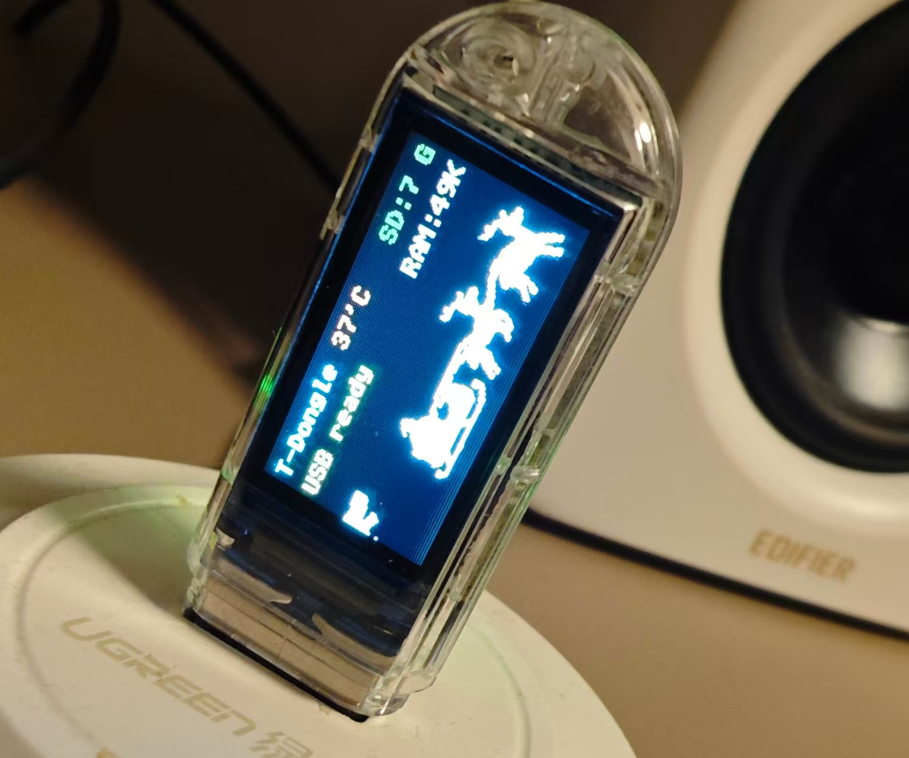

# T-Dongle Key

[中文](README.md) · [English](README.en.md)

Turn a screen-equipped T-Dongle S3 into a multi-protocol USB security key. Built on the Pico Keys ecosystem, T-Dongle Key combines FIDO2, OpenPGP, PIV, OATH and OTP with a device-status interface and a desktop emulator for development and regression testing.

<p align="center"></p>

## Features

- Integrated FIDO2/U2F, OpenPGP, PIV, OATH and OTP applications.
- Shared LVGL status screens, authentication feedback, sleep state and animation.
- LilyGO T-Dongle S3 target with Pico 2 W build support.
- Storage and compatibility paths for isolated OpenPGP storage, PIN verification and version migration.
- Desktop emulation with SDL2 and a software backend for protocol/UI regression tests.
- Pinned submodules for Pico FIDO, Pico OpenPGP, Pico Keys SDK and LVGL.

## Quick start

A C/C++ toolchain, CMake, pkg-config, SDL2, Python 3 and Git. Hardware builds additionally require the matching ESP-IDF or Pico SDK.

```sh
git clone https://github.com/HaltCatch/t-dongle-key.git
cd t-dongle-key
bash tools/checkout-deps.sh
bash tools/run-desktop.sh --test
# Start the interactive emulator:
bash tools/run-desktop.sh
```

## Configuration

| Setting | Purpose |
| --- | --- |
| `PICO_FIDO_ESP_BOARD` | ESP32 board target; use `tdongle-s3` for T-Dongle. |
| `ENABLE_EMULATION` | Enable the desktop software backend. |
| `ENABLE_OATH_APP / ENABLE_OTP_APP` | OATH/OTP switches in the combined firmware. |
| `USB_VID / USB_PID / VIDPID` | USB identity and compatibility profile; use identifiers appropriate for the target device. |
| `TDONGLE_DESKTOP_BUILD_DIR / TDONGLE_BUILD_JOBS` | Desktop build directory and parallelism. |

## Usage

Use `tools/run-desktop.sh` for desktop development. Build hardware firmware with the target board’s CMake/SDK settings. The emulator uses isolated software storage and does not provide the hardware key protection of a physical device. Based on [CDRLpart/tdongle-yk](https://github.com/CDRLpart/tdongle-yk) and Pico Keys components; this is not an official Yubico product.

## Project structure

- `src/fido2/` — Combined applications and board integration
- `src/fido2/gui/` — Device interface
- `tools/` — Dependency, emulator and build tools
- `tests/` — Protocol and upgrade regressions

## Third-party animation assets

The animation sprites are third-party content. Their original source is no longer known and their license has not been verified. If any asset infringes your rights, please [open an issue](https://github.com/HaltCatch/t-dongle-key/issues) to request removal.

## License

[AGPL-3.0](LICENSE). See [LICENSE_SCOPE.md](LICENSE_SCOPE.md) for the scope of original material and third-party components, and the accompanying notices for third-party copyrights and licenses.
