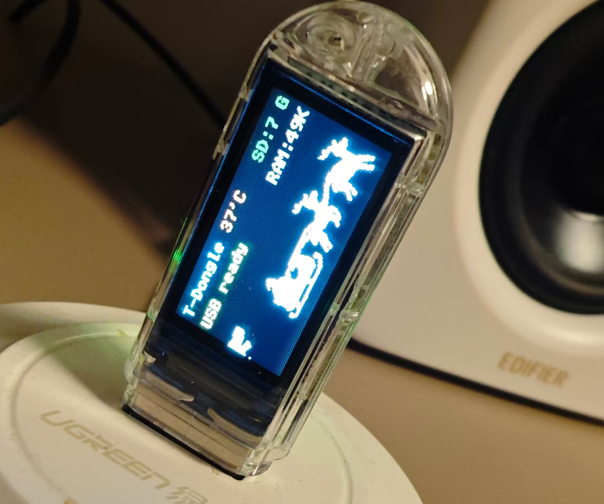

# T-Dongle Key

[中文](README.md) · [English](README.en.md)

把带屏幕的 T-Dongle S3 变成多协议 USB 安全钥匙。T-Dongle Key 在 Pico Keys 生态上整合 FIDO2、OpenPGP、PIV、OATH 与 OTP，并提供设备状态界面和桌面模拟器，便于开发与回归验证。

<p align="center"></p>

## 功能

- 多协议集成：FIDO2/U2F、OpenPGP、PIV、OATH 与 OTP。
- 设备界面：共享 LVGL 状态页、认证反馈、休眠与动画。
- 硬件目标：LilyGO T-Dongle S3，并包含 Pico 2 W 相关构建支持。
- 存储与兼容：OpenPGP 独立存储、PIN 校验及版本兼容路径。
- 桌面模拟：SDL2 界面与软件后端，可执行协议和界面回归测试。
- 固定依赖：Pico FIDO、Pico OpenPGP、Pico Keys SDK 与 LVGL 由子模块提交确定。

## 快速开始

C/C++ 工具链、CMake、pkg-config、SDL2、Python 3 与 Git。实物构建另需匹配的 ESP-IDF 或 Pico SDK。

```sh
git clone https://github.com/HaltCatch/t-dongle-key.git
cd t-dongle-key
bash tools/checkout-deps.sh
bash tools/run-desktop.sh --test
# Start the interactive emulator:
bash tools/run-desktop.sh
```

## 配置

| 配置项 | 说明 |
| --- | --- |
| `PICO_FIDO_ESP_BOARD` | ESP32 目标板，T-Dongle 使用 `tdongle-s3`。 |
| `ENABLE_EMULATION` | 启用桌面软件后端。 |
| `ENABLE_OATH_APP / ENABLE_OTP_APP` | 组合固件中的 OATH/OTP 功能开关。 |
| `USB_VID / USB_PID / VIDPID` | USB 标识及兼容配置；使用适合目标设备的合法标识。 |
| `TDONGLE_DESKTOP_BUILD_DIR / TDONGLE_BUILD_JOBS` | 桌面构建目录与并行度。 |

## 使用

`tools/run-desktop.sh` 用于桌面开发；硬件固件根据目标板的 CMake/SDK 配置构建。桌面模拟器使用隔离的软件存储，不代表真实设备的硬件密钥保护。项目基于 [CDRLpart/tdongle-yk](https://github.com/CDRLpart/tdongle-yk)，并集成 Pico Keys 系列组件；不是 Yubico 官方产品。

## 项目结构

- `src/fido2/` — 组合应用与板级接入
- `src/fido2/gui/` — 设备界面
- `tools/` — 依赖、模拟器与构建工具
- `tests/` — 协议与升级回归

## 第三方动画素材

动画精灵属于第三方内容，原始来源已无法确认，许可尚未核实。如有侵权，请通过 [Issues](https://github.com/HaltCatch/t-dongle-key/issues) 联系删除。

## 许可

[AGPL-3.0](LICENSE)。原创部分与第三方组件的适用范围见 [LICENSE_SCOPE.md](LICENSE_SCOPE.md)；各第三方版权和许可见相应声明文件。
